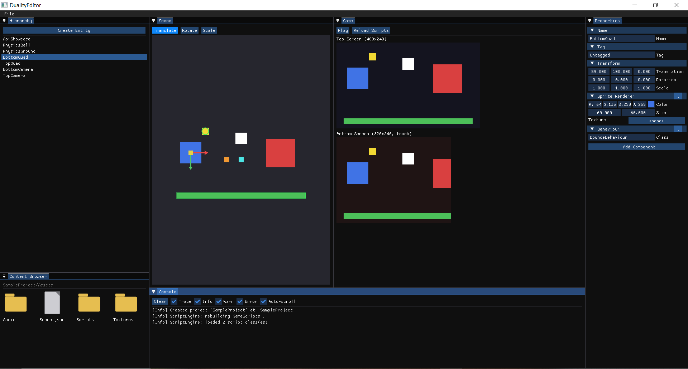
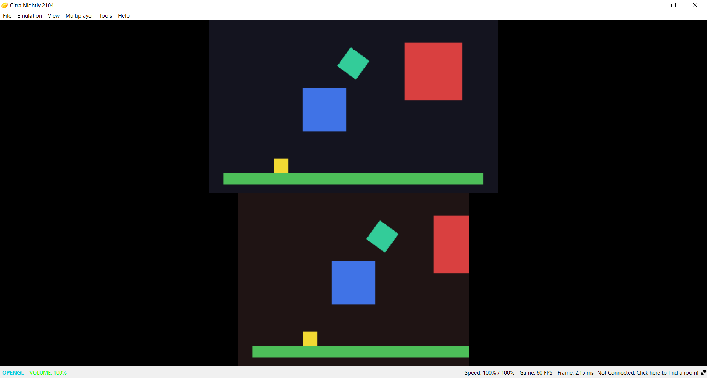

# DualityEngine

A from-scratch C++ game engine + Unity/Cocos-Creator-style drag-and-drop
editor targeting the Nintendo 3DS (devkitARM/devkitPro), developed on
Windows. The same `DualityEngine` core (ECS, reflection, scene
serialization, 2D physics via Box2D, 3D physics via Bullet) compiles for
three targets from one source tree:

- **Desktop** -- `DualityEditor.exe`, the drag-and-drop editor (Dear ImGui).
- **Desktop standalone** -- `DualityPlayerDesktop.exe`, a real GLFW window
  running the same project with no Editor UI at all (an "export to
  Windows" build).
- **3DS** -- `DualityPlayer`, the actual game runtime, built as `.3dsx`
  (Homebrew Launcher / `3dslink`) and `.cia` (installable via FBI on real
  hardware/CFW).

Both 2D (sprites, flipbook animation) and 3D (Unity-style Materials/Shaders with
per-pixel lighting -- see "Rendering: Materials, Shaders & Lighting" -- OBJ/FBX import,
skinned meshes) render
and physics-simulate side by side on the same screen -- a camera's projection
is just a lens property (Unity's own convention), never a switch between
mutually exclusive pipelines.





New here? `GETTING_STARTED.md` is a hands-on walkthrough (build, tour the Editor,
build a scene, write your first script) -- this file covers architecture, the full
build system, and every feature's details instead. See `ROADMAP.md` for what's
planned but not built yet.

## Prerequisites

1. **devkitPro**, with the 3DS packages installed (`devkitARM`, `citro2d`,
   `citro3d`, `3dstools`, `3ds-cmake`, `general-tools`, etc. -- installed via
   the devkitPro updater/pacman). The `DEVKITPRO` environment variable
   should point at the install (typically `E:\App\devkitPro` or
   `C:\devkitPro`).
2. **A MinGW-w64 toolchain for the desktop build.** devkitPro bundles its
   own MSYS2 install, which does not include this by default -- add it once
   from an MSYS2 shell:
   ```
   pacman -S mingw-w64-x86_64-toolchain mingw-w64-x86_64-glfw \
             mingw-w64-x86_64-glew mingw-w64-x86_64-cmake mingw-w64-x86_64-ninja
   ```
3. **Citra** (or a real 3DS), to run the `.3dsx`/`.cia` output.

If your machine already has another MSYS2/MinGW/Ninja install, make sure it
doesn't shadow devkitPro's on `PATH` -- `build.bat` explicitly prepends
devkitPro's own `msys2\mingw64\bin` to avoid exactly that conflict.

## Desktop: build and run the Editor

```
build.bat               REM configures + builds the Editor, standalone player, and Tests/
run.bat                 REM launches the Editor (sets PATH so glfw3.dll/glew32.dll resolve)
run-desktop-player.bat  REM launches the standalone player (build.bat's DualityPlayerDesktop.exe)
run-tests.bat           REM runs the automated engine-logic test suite (see "Testing" below)
```

`build.bat` re-configures automatically if the build cache looks stale.

### Using the Editor

On launch, the Editor opens (creating if needed) a fixed sample project at
`SampleProject/` next to the executable. A different project can be created
or opened via the File menu.

#### Unity-style workflow (layout, shortcuts, undo, selection)

The Editor mirrors Unity's editor: names, menus, shortcuts and behaviour. Full reference
(with the shortcut table): `Docs/pages/editor.html`.

- **Look & layout** -- Unity's dark skin (Edit > Preferences > Color Theme: Unity Dark
  default; Blue/Pink/Dark kept), the OS's Segoe UI font loaded at runtime (never copied into
  the repo; falls back to ImGui's bitmap font), Font Awesome icons. Default dock layout:
  Hierarchy left, Scene/Game tabs center, Inspector right, Project/Console tabs bottom. The
  layout persists in `imgui.ini` (the old "Project window" window entry is renamed to
  "Project" automatically); Window > Layouts > Reset (or the toolbar's Layout button)
  rebuilds the default; Window > General reopens any closed panel.
- **Main toolbar** -- Q/W/E/R/T tools (View, Move, Rotate, Scale, Rect), Pivot/Center (Z),
  Global/Local (X), increment-snap settings (magnet), Play/Pause/Step centered (Ctrl+P,
  Ctrl+Shift+P, Ctrl+Alt+P), Layout menu right. Playing tints the whole editor; Stop reverts
  every Play-mode change and keeps the selection; Step advances one fixed 1/60 s frame.
- **Undo/Redo** (Ctrl+Z, Ctrl+Y / Ctrl+Shift+Z) for every scene edit -- field edits, gizmo /
  collider / UI-rect drags, create/delete/duplicate/paste/reparent/reorder, add/remove/reset/
  paste component, active toggles, prefab operations. One interaction = one step (a whole
  drag, a whole typed value); Edit shows "Undo Move" / "Redo Add Rigidbody 2D". Selection and
  Hierarchy foldouts are restored through editor-only stable entity ids (never written to
  scene files). Unsaved scenes show `*` in the window title / menu bar / Hierarchy, and
  switching scene/project or closing asks Save / Don't Save / Cancel.
- **Selection & commands** -- Ctrl/Shift-click and arrow keys in the Hierarchy, click /
  Ctrl-click / marquee in the Scene view, Ctrl+A; Duplicate (Ctrl+D), Copy/Cut/Paste/Paste As
  Child (Ctrl+C/X/V, Ctrl+Shift+V -- EntityRefs inside the copy point at the copies, references
  to other objects are kept), Delete, Rename (F2, inline), Frame (F / double-click), Create
  Empty (Ctrl+Shift+N), Create Empty Child (Alt+Shift+N), Create Empty Parent (Ctrl+Shift+G),
  Toggle Active (Alt+Shift+A). The GameObject menu (3D/2D Object, Effects, Light, Audio, UI,
  Camera) is shared by the main menu, the Hierarchy "+" button and every context menu.
- **Inspector** -- GameObject header (active, name, Tag, Layer, prefab row with Open / Select /
  Overrides: Apply All / Revert All / Unpack), component cards with enable checkbox + kebab
  menu (Reset, Remove, Move Up/Down for scripts, Copy, Paste Values, Paste As New, Edit Script),
  Unity property layout (labels left, X/Y/Z vector fields, color swatch + hex, object fields
  with thumbnails: click pings, double-click selects, a picker button), multi-object editing
  (shared components only, differing values shown as "-", one edit applies to all as one Undo
  step), prefab overrides in bold (right-click > Revert), and a categorized searchable Add
  Component popup with Scripts `(C++)`/`(TS)` and **New Script** (TypeScript or C++).
- **Scene view** (navigation like PiaEngine / Unity; full table in `Docs/pages/editor.html`)
  -- each pane (Top / Bottom screen) has a toolbar (2D | 3D, Grid, Gizmos, pipeline badge)
  and a floating tools column (Hand / Move / Rotate / Scale / Rect). 3D: LMB select (click,
  Ctrl/Shift toggle, drag = marquee), MMB pan (the point under the cursor follows it), RMB
  look + WASD/QE fly (speed scales with the pivot distance, Shift x3, wheel while flying =
  fly speed, shown bottom-left), Alt+LMB orbit, Alt+RMB dolly, wheel zoom (x1.12 per notch),
  axis gizmo top-right (click a cone = animated snap to that orthographic view, click the
  centre / "Persp" label = perspective <-> iso, drag = orbit), F frames the selection
  (animated). 2D: MMB / RMB / Alt+LMB / Hand pan, wheel zooms toward the cursor (x1.15). The
  grid follows the camera (density by zoom). Each scene remembers its Scene view cameras
  (`<Project>/Library/SceneViewState.json`). Handles for the whole selection, Ctrl increment
  snapping (Move 0.25, Rotate 15 deg, Scale 0.1), orange selection outlines, a draggable
  splitter between the panes.
- **Console** -- Clear, Collapse, Clear on Play, Error Pause, per-level counts/toggles, search,
  a details pane with the full selected message.
- **Project** (was "Project window") -- folder tree + grid, "+" Create menu, clickable
  breadcrumb, project-wide search, icon-size slider (Ctrl+wheel), Show in Explorer / Open /
  Copy Path, F2 / Delete / Ctrl+D, drag a Hierarchy object in to make a prefab, ping highlight.
- **File > Open Recent Project** keeps the last 10 projects (`EditorSettings.json`).
- **Automation** -- `DualityEditor --editor-test script.txt [--project X.dproj] [--size WxH]`
  drives the editor in-process (ImGui input queue + editor commands, offscreen screenshots,
  `expect-*` checks; exit code = failures) without touching the desktop's real mouse/keyboard.

#### Built-in components (Unity names, Add Component categories)

Besides Sprite/Mesh/Skinned renderers, lights, camera, audio, particles, Line Renderer,
Tilemap, Rigidbody 2D/3D, Box/Circle/Capsule/Polygon Collider 2D, Box/Sphere/Capsule
Collider 3D and the Canvas UI (Rect, Image, Text, Button, Toggle, Slider, Input Field, Layout
Group), the engine ships (`Scene/Components/*.h`, fields: `Docs/pages/components.html`,
demo: `SampleProject/Assets/ComponentsDemo/ComponentsDemo.scene`):

- **Physics 2D** -- Edge Collider 2D; Distance / Hinge / Spring / Fixed / Slider / Wheel /
  Friction / Relative / Target Joint 2D (Connected Body, anchors draggable in the Scene view,
  Break Force/Torque -> `OnJointBreak2D`); Area / Point / Surface / Platform (one-way) /
  Buoyancy Effector 2D (colliders get **Used By Effector**); Constant Force 2D.
- **Physics 3D** -- Fixed / Hinge (motor, limits, spring) / Spring / Character Joint
  (`OnJointBreak`), Mesh Collider (triangle mesh static, convex hull dynamic), Character
  Controller (`Move`/`SimpleMove`, slope limit, step offset, `isGrounded`,
  `OnControllerColliderHit`), Constant Force.
- **UI** -- Scroll Rect + Scrollbar, Mask / Rect Mask 2D (GPU scissor on desktop **and** 3DS),
  Dropdown, Canvas Group, Grid Layout Group, Content Size Fitter, Aspect Ratio Fitter,
  Shadow / Outline.
- **Rendering / misc** -- Trail Renderer, Text Mesh, LOD Group, Billboard, Position /
  Rotation / Scale / Parent / Look At / Aim Constraint.

All of them serialize like every other component (scenes, prefabs, copy/paste, undo), have
Inspector ranges/enums/entity pickers, Scene-view gizmos where Unity has them, and typed
TypeScript wrappers (`HingeJoint2D`, `CharacterController`, `ScrollRect`, `TextMesh`...).

#### Tool windows: Sprite Editor, Animation, Tile Palette, Profiler

Unity's 2D / animation / analysis windows, opened from the **Window** menu (details and
shortcuts: `Docs/pages/editor.html`, sample: `SampleProject/Assets/SpriteToolsDemo/`).

- **Sprite Editor** (Window > 2D > Sprite Editor, or the texture Inspector's **Sprite Editor**
  button). The texture Inspector has **Sprite Mode** (Single / Multiple) and **Pixels Per Unit**.
  Multiple mode slices a texture into sprites: **Slice** menu (Automatic by alpha islands, Grid By
  Cell Size, Grid By Cell Count; offset, padding, Keep Empty Rects, pivot, Delete Existing / Safe),
  drag on empty space to draw a rect, move / resize with handles, **Trim**, Delete. Every sprite
  has a name, a pivot (presets or the blue pivot handle) and a 9-slice border (green handles);
  Single mode edits the whole texture's pivot / border. Changes stay in the window (own Undo /
  Redo, Ctrl+Z while it is focused) until **Apply**; **Revert** drops them. Sprites live in the
  texture's `.meta` (`Importer.Sprites`) and are referenced as `"<textureGuid>#<spriteId>"`
  wherever a texture can be assigned (SpriteRenderer, UI Image, Sprite Flipbook frames, Sprite
  Sheet Animator, Particle System); a plain GUID still means the whole texture, so existing scenes
  are unchanged. A Multiple texture unfolds into its sprites in the **Project** window; sprites
  drag onto fields, into the Scene (a SpriteRenderer at native size = rect / PPU) or the
  Hierarchy. SpriteRenderer gained **Draw Mode** (Simple / Sliced: 9-slice with the sprite's
  border); a sprite's pivot replaces the renderer's Pivot (like Unity). Desktop and 3DS draw the
  sub-rect (Citro2D maps it through the `.t3x` subtexture, so power-of-two padding and the 1024
  px resize are handled); builds ship the texture of every referenced sprite with its sprite data.
- **Animation** (Window > Animation > Animation, Ctrl+6) for the selected object's Animation clip:
  property list + **Dopesheet** / **Curves** view, **Add Property** (any reflected field of the
  object or its children), keyframes (double-click adds, drag moves, Delete removes), playback /
  scrubbing in Edit mode as a preview that restores the authored values afterwards (never saved,
  never dirties the scene), **Record** mode (changing a field keys it at the playhead), sprite
  keyframes (drop sprites, or a whole sliced texture, on the timeline = a flipbook clip at 12
  samples/s), **Create** a new clip (+ Animation component). Clip edits are written to the `.anim`
  immediately and are part of the scene Undo history. Imported model clips are read-only.
- **Tile Palette** (Window > 2D > Tile Palette): the active Tilemap's tileset sprites as a
  palette (click a tile or drag a rectangle = multi-tile brush), tools Paint (B), Box Fill (U),
  Picker (I), Erase (D), Flood Fill (G) painting in the Scene view; one stroke = one Undo step
  (the `.tilemap` file is tracked by the scene history; a missing tile-data asset is created in
  `Assets/Tilemaps/`). A tile index is the index of a sprite in the tileset's sprite list;
  tilemaps now sort with sprites by Sort Order and also draw in the Scene view.
- **Profiler** (Window > Analysis > Profiler, Ctrl+7): records while open -- a stacked CPU
  graph (Rendering, Scripts, Physics, Animation, UI, Editor, Others), a Rendering / Memory
  counter chart (draw calls, sprites, meshes, texture memory, JS heap, entities) and the
  Hierarchy table (Total / Self %, calls, ms) of the selected frame. Markers come from
  `DUALITY_PROFILE_SCOPE` (`Core/Profiler.h`): PlayerLoop, Scripts.C++ / Scripts.TypeScript,
  Physics.FixedStep, Scene.RuntimeSystems / Animation.Sample, Render.3D / Render.2D /
  Render.UI, UI.Events; they compile out of the 3DS player.


- **File menu** (top) -- **New Project...** (pick a location + name via a
  native Save dialog -- e.g. choosing `F:\Projects\MyGame.dproj` creates
  `F:\Projects\MyGame\MyGame.dproj` + `F:\Projects\MyGame\Assets\`, a
  dedicated project folder with the `.dproj` at its own root, matching
  Unity's own "New Project" flow), **Open Project...** (browse for a
  `.dproj` file; swaps the active project/scene/Project window root,
  stopping Play first if it's running), **New Scene** (Ctrl+N, an untitled
  scene with one root + 2D camera per screen), **Open Scene...** (Ctrl+O),
  **Revert Scene** (reload the open scene from disk, discarding edits after
  asking), **Save** (Ctrl+S) and **Save As...** (Ctrl+Shift+S -- now Unity's
  behaviour: writes the scene to a new file *and* makes that file the open
  scene; still how a project gets a second scene file for
  `SceneManager`/`Behaviour::LoadScene` to target), and **Build for
  3DS** (saves the scene, then runs `build-3ds.bat`, see below, so the
  on-device build always packages the latest scene), and **Build for PC**
  (saves the scene, then rebuilds `DualityPlayerDesktop` in the existing
  desktop build tree -- no romfs/asset-cooking step needed, since that
  target reads a project's `Assets/` directly off disk at its own launch
  time; run it via `run-desktop-player.bat` once built), and **Build
  Settings...** (a separate window -- see below). Both build actions share
  one build-status flag, so they can't run concurrently against the same
  build tools. The menu bar also shows which scene file is currently active
  (`Scene: <filename>`), since **Open Scene...**/a Project window
  double-click/the Scene asset inspector's own "Open Scene" button can all
  change it.
- **Build Settings...** window (File menu) -- Unity's own Build Settings
  dialog: a **Scenes In Build** list (drag a row to reorder, "x" to remove;
  the topmost entry is the Start Scene) plus an auto-scanned **Other Scenes
  In Project** list to add from, and a **Build for 3DS** button + progress
  bar right in the window. Backed by a persisted `ProjectConfig::ScenesInBuild`
  field: once configured, only listed scenes are cooked into a 3DS build and
  the topmost one ships as the on-device boot scene (an empty/unconfigured
  list falls back to the old behavior -- ship every `.scene` found, package
  whatever's currently open).
- **Edit menu** (top) -- **Project Settings...** (Name/Assets Directory/Scripts
  Directory are read-only for this first pass; an **Icon (3DS)** section is
  editable though -- preview + **Browse...** to pick a PNG, persisted as
  `ProjectConfig::IconPath` and threaded into the actual `.cia` build's
  `bannertool makesmdh` step, falling back to the engine's placeholder icon
  when unset) and **Preferences...** (pick an external
  editor executable via **Browse...**, then **Open Project in External
  Editor** launches it with the active project's folder as its argument --
  persisted per-machine, not per-project, at
  `%APPDATA%\DualityEngine\EditorSettings.json`).
- **Hierarchy** (left) -- lists entities in the scene; click one to select
  it. **Create Entity** adds a new empty entity and selects it. A search box
  filters to a flat scene-wide list of matching entities while it has text
  (tree/drag-drop return once it's cleared). Right-click an entity for
  **Create Child Entity** or **Create Prefab from Selection** (writes
  `Assets/Prefabs/<Name>.prefab`); drag a Prefab asset from the Content
  Browser onto empty space in this panel to instantiate it.
- **Inspector** (right) -- shows every component on the selected entity,
  fields fully generic (reflection-driven -- adding a new component/field
  never needs editor code changes). Every entity has an **Active** checkbox
  (Unity's `GameObject.SetActive`) alongside Transform/Name/Tag. Each
  non-mandatory component has a "..." button to remove it; **+ Add
  Component** at the bottom lists every component type not already on the
  entity. **Lock** (top, Unity-Inspector-style) pins the panel to whatever's
  currently shown, ignoring further Hierarchy/Scene/Project window
  selections until unlocked -- needed because clicking a Project window
  thumbnail to start dragging it (e.g. a Material/Texture onto an `AssetRef`
  field here) fires on mouse-down -- fixed to fire on release-while-still-
  hovering instead (`ContentBrowserPanel`'s own thumbnail button), so Lock
  is no longer *required* just to drag-and-drop an asset (still useful for
  pinning Properties while browsing elsewhere).
- **Scene** (center, tabbed with Game) -- one free-roam edit camera per
  screen, independent of any in-scene camera, with a **2D | 3D** toggle per
  pane. Both draw a Unity/Cocos-style grid (world-aligned lines, a red
  X-axis/green Y-or-Z-axis line through the origin) so you always have a
  sense of scale/position. 2D: middle-drag to pan, wheel to zoom, left-click
  a sprite to select it. 3D: left-click/drag to select and gizmo-drag,
  right-drag to orbit (a genuine quaternion orbit -- no gimbal-lock clamp,
  it flips smoothly through the poles like Unity/Blender), middle-drag to
  pan, wheel to zoom; a Blender/Unity-style orientation gizmo sits in the
  pane's top-right corner -- click one of its axis tips to snap the view to
  look straight down that axis. The viewport always exactly fills the
  panel. Camera entities draw a real frustum wireframe (near/far planes,
  FOV) instead of a flat marker, so you can see exactly where a camera is
  looking, and a camera's **Background** color field (Properties, Unity's
  `Camera.backgroundColor`) is what that screen actually clears to whenever
  a camera is present. **Translate / Rotate / Scale** buttons switch the selected
  entity's gizmo mode -- drag a handle to edit its Transform live, visible
  immediately in Scene, Game, and on a real 3DS build. `Transform.Rotation`
  is always in degrees. Colliders
  (`BoxCollider2D`/`CircleCollider2D`/`BoxCollider3D`/`SphereCollider3D`)
  draw as a green wireframe outline for the SELECTED entity only -- an
  editor-only visualization, like Unity's Gizmos, never actually rendered
  in the Game view or on-device. A per-collider **Edit** checkbox in
  Properties (`EditMode`, off by default) gates whether that wireframe's
  resize handles actually respond to a drag -- one handle per axis for 2D
  (`Size.x`/`Size.y`, or a single radius handle) and 3D (box: one per face;
  sphere: one on the equator) alike, editing `Size`/`Radius` directly in
  whichever Scene pane the collider is drawn in.
- **Game** (center, tabbed with Scene) -- exactly what the real
  TopCamera/BottomCamera entities render, stacked to match the console's
  physical layout (Top 400x240 above, Bottom 320x240 below). This is the
  same render pass the 3DS build itself uses. **Play / Stop** runs the full
  runtime lifecycle (`Behaviour` scripts, 2D/3D physics, collision/trigger
  events, UI) against the live scene and, on Stop, reverts every change
  Play made -- script-driven Transform edits, physics results, runtime-
  spawned/destroyed entities -- back to exactly how the scene looked the
  instant Play was pressed, matching Unity's own Play/Stop guarantee.
  **Reload Scripts** rebuilds `GameScripts` and hot-reloads it into the
  running Editor without restarting (stopping -- and reverting -- Play
  first if it's running) -- edit a script's `.cpp`, click this, see the
  change immediately. Runs on a background thread (the button relabels to
  "Reload Scripts (reloading...)" and grays out, same as Build for
  3DS/PC), so the Editor's UI stays responsive during the rebuild instead
  of freezing for its duration. Clicking/touching either screen's image here (while
  Playing) is correctly resolved to that screen's own local pixel
  coordinates, so `Behaviour::GetPointerPosition()`/`ScreenPointToRay3D`
  work the same in Play-in-Editor as they do on `DualityPlayerDesktop` or a
  real 3DS.
- **Console** (bottom, tabbed with Project window) -- `Duality::Log`
  output (including `Behaviour::LogInfo/LogWarn/LogError` calls from
  scripts), color-coded and filterable by level (Trace/Info/Warn/Error),
  plus a text search box and a Clear button.
- **Project window** (bottom, tabbed with Console) -- browses
  `SampleProject/Assets/` as a grid of icons, with real thumbnails for image
  files, and a search box that filters files by name within the current
  folder (folders themselves stay visible so navigation keeps working).
  Every asset gets a companion `<name>.meta` file (a stable GUID,
  Unity/Unreal-style) generated the first time the Project window sees it;
  `.meta` files themselves are hidden from the grid. Drag an asset out onto
  an `AssetRef` field in Properties (a texture, a Material, a Prefab, ...)
  to assign it (referenced by its GUID, so renaming/moving the file later
  doesn't break it); drag a file in from Windows Explorer to import it into
  whatever folder is currently open. Click a file once to select it (fires
  on release, not press, so starting a drag doesn't also reselect the file
  being dragged) --
  Properties shows the right Inspector for its type, dispatched by file
  extension through `AssetInspectorRegistry` (`DualityEditor/
  AssetInspectors.cpp`) the same way `TypeRegistry` dispatches Entity
  components: `.mat`/`.asset` (Material/ScriptableObject) are fully editable,
  auto-saving on every change; `.prefab`/`.scene` show a read-only summary
  (entity count, root/top-level entity names -- editing a Prefab or Scene
  asset in place isn't built yet, see "Known limitations"); a `.scene`'s
  Inspector also has an **Open Scene** button, and double-clicking a
  `.scene` file (instead of single-clicking to select it) opens it directly
  as the active scene; an image or
  `.wav` shows its **Import Settings** (Filter Mode/Wrap Mode/Generate
  Mipmaps for a texture, Volume for audio) -- a Unity/Cocos-style importer
  block written into that asset's own `.meta` file (alongside its existing
  `"guid"` key) rather than the asset itself, since a `.png`/`.wav` is a
  foreign binary format this engine doesn't own. Right-click empty space for
  **Create > Folder / Scene / Material / ScriptableObject > &lt;Type&gt;**
  (the latter listing every class GameScripts currently has
  `REGISTER_SCRIPTABLE_OBJECT`'d); right-click an existing file or folder for
  **Rename** (label becomes an editable text field, Enter or click-away
  commits, Escape cancels) or **Delete** (asks for confirmation first --
  there's no Recycle Bin/undo here). Drag a file onto a folder icon to move
  it there (its `.meta` sidecar moves with it, and its GUID keeps resolving
  to the new path, so nothing referencing it needs fixing up).

### Writing gameplay scripts

Gameplay scripts can be written in **C++** (this section) or **TypeScript**
(see "TypeScript scripts (QuickJS)" below) -- both kinds live side by side on
the same entity, appear in the same **Add Component** list, serialize into the
same scene JSON and run through the exact same lifecycle dispatch.

C++ scripts compile into one `GameScripts` module either way -- a hot-reloadable
DLL for desktop Play-in-Editor, or linked statically straight into
`DualityPlayer` for the 3DS build (same source files, no code changes either
way) -- from two possible locations:

- **A project's own scripts** (the common case): right-click in the Content
  Browser (inside `Assets/Scripts/` or anywhere else under the project's
  `Assets/`) and pick **Create > C++ Script**. Writes a ready-to-edit `.h`/`.cpp`
  pair (`NewBehaviour`, `NewBehaviour1`, ... if the plain name is taken --
  unlike Scene/Material's `"NewScene (1)"` numbering, a script's filename has
  to stay a valid C++ identifier, since it also becomes the class name) with
  the `REGISTER_BEHAVIOUR` boilerplate already in place. No `CMakeLists.txt`
  editing needed -- every `.cpp` under the active project's own
  `Assets/Scripts/` (recursively) is picked up automatically the next time
  **Reload Scripts** runs, alongside the engine's own shared scripts below.
- **A shared engine-level script** (for something meant to ship as an
  example/demo alongside the engine itself, like `BounceBehaviour`): add a
  class deriving from `Duality::Behaviour` under `GameScripts/Include/` +
  `Source/` by hand (see `BounceBehaviour.h`/`.cpp` for the pattern), then
  add the new source file to `GameScripts/CMakeLists.txt`'s explicit list.

Either way:

1. Override whichever lifecycle methods the script needs (see below).
2. Register it with `REGISTER_BEHAVIOUR(YourClassName)` at the bottom of its
   `.cpp` file (already there if created via Project window).
3. In the Editor, select an entity, click **+ Add Component > Add Script**,
   and pick the class from the submenu (every `REGISTER_BEHAVIOUR`'d class
   shows up there automatically -- project-owned and engine-shared scripts
   both, no distinction once compiled), then click **Reload Scripts**. One
   entity can carry any number of different scripts at once (or the same one
   more than once), matching Unity letting one GameObject carry many
   MonoBehaviours -- each gets its own card in the Properties panel, with
   its own "..." > Remove Script.

### Inspector-editable fields

A script's own public fields can show up in the Properties panel, like
Unity's `[SerializeField]` -- a real per-field attribute, Unreal
`UPROPERTY()`-style:

```cpp
class BounceBehaviour : public Duality::Behaviour {
public:
    DUALITY_PROPERTY() float Amplitude = 40.0f;
    DUALITY_PROPERTY() float Speed = 8.0f;
    DUALITY_PROPERTY() Duality::EntityRef Target;   // drag an entity from the Hierarchy onto this field

    DUALITY_PROPERTIES_AUTO()
    ...
};
```

`DUALITY_PROPERTY()` marks a field; `DUALITY_PROPERTIES_AUTO()` (one line,
no arguments) declares the class's `Fields()` method. Both are entirely
optional -- a script with neither just has no Inspector fields, exactly like
before this feature existed. The actual `Fields()` *definition* is
generated by `GameScripts/CodeGen/generate_fields.py`, a small pre-build
step (wired into `GameScripts/CMakeLists.txt`) that scans every header
under `GameScripts/Include/` for the `DUALITY_PROPERTY()` marker and emits
`GameScripts/Generated/ScriptFields.generated.cpp` -- the same real
code-generation approach Unreal Header Tool and Polyphase-Engine's own C#
scripting layer use, since a bare per-field marker macro genuinely can't
see its own attached declaration's name/type through the preprocessor
alone. There's no separate "component reference" field type: hold an
`EntityRef` and call `ResolveEntityRef(ref).GetComponent<T>()` to reach a
specific component on whatever entity it points at. Edits made in Edit mode
are saved with the scene; edits made while Play is running affect the live
object only and are lost on Stop (matching Unity's own behavior). One
limitation: an `EntityRef` field does NOT survive a scene save/load round
trip -- it always reloads as unset, since a raw handle isn't stable across a
reload (see "Known limitations").

### Lifecycle

- `OnCreate()` -- once, when Play starts (Unity's `Awake`, runs even if the
  entity starts inactive).
- `OnEnable()` / `OnDisable()` -- fire whenever `Scene::IsEffectivelyActive`
  flips for this entity (its own `SetActive` call, or a parent's) -- can
  fire many times across one Play session. `OnUpdate` simply isn't called
  while inactive.
- `OnUpdate(float deltaTime)` -- every frame, while active.
- `OnLateUpdate(float deltaTime)` -- every frame, after EVERY script's
  `OnUpdate` (camera follow etc.), same gating.
- `OnFixedUpdate(float fixedDeltaTime)` -- once per fixed 1/60 s physics step
  (0..N times per frame), right before that step is simulated; only for
  scripts that already got `OnEnable`.
- `OnCollisionEnter(Entity other)` / `OnCollisionExit(Entity other)` --
  fires for BOTH sides of a touching pair (Unity's own convention) when
  neither collider involved is a trigger. Works identically whether `other`
  is a 2D or 3D entity.
- `OnTriggerEnter(Entity other)` / `OnTriggerExit(Entity other)` -- same as
  above, but for a pair where at least one collider has `IsTrigger` set.
- `OnDestroy()` -- once, at Stop (a still-enabled instance gets one final
  `OnDisable()` immediately before this), or at the end of the frame its
  entity was destroyed (`ScriptScene::Destroy(entity)` / TS `destroy(go)`).

Entities that appear **during Play** -- a prefab spawned with
`ScriptScene::Instantiate` / TS `instantiate`, or a script added at runtime --
get their physics bodies and script instances (Awake) immediately, then
`OnEnable`/`OnUpdate` from the next frame, like Unity. Destroying an entity
during Play is deferred to the end of the frame (scripts get
`OnDisable`/`OnDestroy`, Box2D/Bullet bodies are released).

### Scripting API

`Behaviour` giữ lifecycle, `GetComponent`, `SetActive`, `ResolveEntityRef`, và
factory helpers (`GetRigidbody2D/3D`, `GetAudioSource`). Các API engine còn lại
là Unity-style static classes trong `DualityEngine/Scripting/` (Scene bind
`ScriptContext` trước mỗi callback). Một include duy nhất cho script (giống `using
UnityEngine;`): `#include "DualityEngine/Scripting/Scripting.h"` (Behaviour + mọi wrapper,
header-only); include từng header riêng như trước vẫn dùng được.

| Unity | Duality |
|-------|---------|
| `Input` | `Duality::Input` |
| `Debug.Log` | `Duality::ScriptDebug` |
| `Physics2D` / `Physics` | `Duality::ScriptPhysics2D` / `ScriptPhysics3D` |
| `SceneManager.LoadScene` | `Duality::SceneManager::RequestLoadScene` |
| `Object.Instantiate` | `Duality::ScriptScene::Instantiate` |
| `Rigidbody2D` | `GetRigidbody2D()` → `Rigidbody2D` wrapper |
| `AudioSource` | `GetAudioSource()` hoặc `AudioSourceComponent` + `GetAudioSource().Play()` |
| `MeshFilter.sharedMesh` | `MeshFilter(GetEntity()).SetMesh(MeshPrimitive::Sphere)` / `SetMesh(assetRef)` |
| `MeshRenderer.material.color` | `MeshRenderer(GetEntity()).SetMaterialColor(color)` |

- **Active state** (trên `Behaviour`): `SetActive(bool)` / `IsActive()`.
- **Rigidbody**: `GetRigidbody2D().SetVelocity(v)` / `AddForce(f)` (và `GetRigidbody3D()`).
- **Raycast**: `ScriptPhysics3D::Raycast(origin, dir, maxDist)` và
  `ScriptPhysics3D::ScreenPointToRay(screen, point, outOrigin, outDir)` --
  chỉ hoạt động khi Play đang chạy.
- **Input**: `Input::GetKeyDown(KeyCode::Space)`, `GetAxis("Horizontal")`,
  `GetPointerDown()`, `GetPointerPosition()`, `GetPointerScreen()`.
- **Audio (one-shot)**: `ScriptAudio::PlaySound(assetGuid, loop)` /
  `StopAllSounds()`.
- **AudioSource (per-entity)**: thêm `Audio Source` component trong Editor
  (Clip/Loop/Volume/Play On Awake), rồi `GetAudioSource().Play()` /
  `Stop()` / `Pause()` / `SetVolume(v)` / `IsPlaying()`.
- **Logging**: `ScriptDebug::LogInfo` / `LogWarn` / `LogError`.
- **Cross-screen lookup**: `ScriptScene::FindEntityInTopScreen(name)` /
  `FindEntityInBottomScreen(name)` -- tìm trong subtree của entity gốc có
  `LayerComponent` TOP/BOTTOM.
- **Scene / Prefabs / Data**: `SceneManager::RequestLoadScene(path)`,
  `ScriptScene::Instantiate(guid)`, `ScriptScene::LoadScriptableObject<T>(guid)`.

**Layers** (thay `Screen Group` cũ): `LayerComponent` với `Default`, `TOP`,
`BOTTOM` -- TOP/BOTTOM map tới hai màn 3DS (citro2d `GFX_TOP`/`GFX_BOTTOM`).
Camera có thêm `Culling Mask` để lọc layer giống Unity.

Header-only, không cần `Behaviour`: `SaveSystem`, `DateTime`, `SceneManager`.

`GameScripts/Source/ApiShowcaseBehaviour.cpp` demo Input/AudioSource/Save/DateTime;
`RaycastDemoBehaviour.cpp` demo `ScriptPhysics3D`.
the sample scene -- move it with WASD/the Circle Pad, hold the pointer to
pull it toward the cursor/touch, press Space/A for a beep, and watch it
spin once a minute, driven by the real clock.
`GameScripts/Source/CollisionLogBehaviour.cpp` is the equivalent living
example for the collision/trigger lifecycle -- attach it to any entity with
a Rigidbody + collider and watch the Console panel as it touches things.
`GameScripts/Include/GameSettingsData.h` is the `ScriptableObject` demo
(`PlayerSpeed`/`ScorePerCoin`/`GameTitle`); `SampleProject/Assets/
GameSettings.asset` is a real instance of it, editable in Properties by
selecting it in the Project window.

**C++ ↔ TypeScript**: `Behaviour::FindScript("ClassName")`,
`GetScriptField("Mover", "speed", value)` / `SetScriptField(...)` and
`SendScriptMessage("Mover", "jump")` reach any other script on an entity --
C++ or TypeScript -- by class name (through `EngineServices`, so they work
across the desktop DLL boundary too).

### TypeScript scripts (QuickJS)

Gameplay scripts can also be written in **TypeScript**, with a Unity/PiaEngine-
style API, running on an embedded **QuickJS-ng** interpreter
(`Vendor/quickjs-ng`, v0.17.0) on desktop *and* on the 3DS:

```ts
// SampleProject/Assets/TypeScriptDemo/Scripts/Spawner.ts (shortened)
import { MonoBehaviour, Prefab, Random, Vector3, WaitForSeconds, field } from 'duality';

export class Spawner extends MonoBehaviour {
  @field(Prefab) prefab: Prefab | null = null;          // drag a .prefab here
  @field({ range: [0.05, 5] }) interval = 0.6;           // slider
  @field('int') maxAlive = 8;                            // integer field
  spreadX = 1.4;                                         // plain public field: shown + saved

  start() { this.startCoroutine(this.spawnLoop()); }

  *spawnLoop() {
    for (;;) {
      const x = Random.range(-this.spreadX, this.spreadX);
      this.instantiate(this.prefab!, null, this.transform.position.add(new Vector3(x, 0, 0)));
      yield new WaitForSeconds(this.interval);
    }
  }
}
```

- **Where**: any `*.ts` under the project's `Assets/` (Project window
  **Create > TypeScript Script**). Every *exported* class extending
  `MonoBehaviour` is a script class (name = export name; must not clash with
  a C++ class) and shows in **Add Component** as `Name (TS)`.
- **Toolchain**: `Tools/TypeScript/build-scripts.mjs` (Node.js + esbuild +
  TypeScript, `npm install`ed automatically on first use) bundles all of a
  project's scripts plus the `duality` API (`Tools/TypeScript/duality/
  duality.ts`) into ONE file, `<project>/Library/ScriptAssemblies/scripts.js`
  (+ source map). It also writes `<project>/tsconfig.json` and
  `Library/Types/duality.d.ts` so VS Code gives completions/type errors.
  Requires `node` on `PATH` for the Editor and the build scripts (the
  *players* only need the bundle).
- **Editor**: compiles + loads the bundle at startup (before the scene is
  read), watches `*.ts` and recompiles in the background on save (type-checked;
  errors appear in the Console as `Assets/...ts:line:col: message`, and any
  syntax/type error keeps the previous scripts loaded, like Unity). A change
  made during Play is applied right after Stop -- live instances are never
  swapped mid-Play. **Reload Scripts** rebuilds C++ and TS together. Script
  errors at runtime are logged with the TypeScript file:line (source map) and
  disable only the faulty script for that Play session (same rule as C++
  exceptions). A per-call watchdog interrupts infinite loops (3 s desktop,
  5 s 3DS).
- **Players**: `DualityPlayerDesktop` loads `Library/ScriptAssemblies/
  scripts.js`; **Build for 3DS** (`BuildPipeline::CookTypeScript`) bundles in
  release mode, compiles it to QuickJS **bytecode** with `DualityJsc`
  (`build/DualityEngine/DualityJsc.exe`, built with the desktop tree) and packs
  `romfs:/Scripts/scripts.jsbc` (+ `scripts.js` fallback + `.map`). Logs go to
  the 3DS debug output (`svcOutputDebugString`; Citra shows it in its log).
- **Fields** (Inspector + scene JSON, the same `PropertyOverrides` format as
  `DUALITY_PROPERTY`): public fields with a number/string/boolean/`Vector2`/
  `Vector3`/`Color`/asset default are picked up automatically (`_private`
  ones never). `@field(...)`: `range: [min,max]` (slider), `'int'`,
  `options: ['A','B']` / `enum: MyEnum` (dropdown), `tooltip`, `header`,
  `GameObject` / `Transform` / a component or script class (entity
  reference), `Prefab` / `AudioClip` / `Texture` / `Material` /
  `ScriptableObject` (asset by GUID), `[GameObject]` / `[Prefab]` (lists).
  `@nonSerialized` hides an auto-detected field.
- **Lifecycle**: `awake`, `onEnable`, `start`, `fixedUpdate`, `update`,
  `lateUpdate`, `onDisable`, `onDestroy`, `onApplicationFocus/Pause/Quit`,
  `onCollisionEnter/Exit(Collision)`, `onTriggerEnter/Exit(Collider)` and the
  2D variants `onCollisionEnter2D(Collision2D)` / `onTriggerEnter2D(Collider2D)`
  (a 2D contact calls the 2D method, falling back to the 3D-named one).
  Coroutines: `startCoroutine(gen)` with `yield null` /
  `WaitForSeconds` / `WaitUntil` / another coroutine; `invoke`,
  `invokeRepeating`.
- **API** (`import { ... } from 'duality'`): `GameObject` (`find`,
  `findWithTag`, `getComponent(s)`, `getComponentInChildren/Parent`,
  `addComponent`, `setActive`, `sendMessage`, `new GameObject(name)`),
  `Transform` (`position`/`localPosition`/`eulerAngles`/`rotation`/
  `localScale`, `translate`, `rotate`, `parent`, `getChild`, `find`,
  allocation-free `getPosition(out)`/`setPosition(x,y,z)`), `instantiate`,
  `destroy(go, delay?)`, `Time`, `Input` (+ `KeyCode`, 3DS buttons,
  touch/mouse), `Debug`/`console`, `Physics2D.raycast/overlapPoint`,
  `Physics.raycast/screenPointToRay`, `SceneManager`, built-in component
  wrappers (`Rigidbody2D`, `Rigidbody`, `Collider2D`, `BoxCollider2D`,
  `CircleCollider2D`, `Collider`, `BoxCollider`, `SphereCollider`,
  `AudioSource`, `SpriteRenderer`, `MeshFilter` (+ `Mesh.builtin(...)`), `MeshRenderer`,
  `Camera`, `ParticleSystem`)
  plus `getComponent('Any Inspector Name').get/set(field)` for every other
  component, C++ scripts via `getComponent('CppClass')` (a `NativeScript` with
  `get/set` of its `DUALITY_PROPERTY` fields), math (`Vector2/3/4`,
  `Quaternion`, `Color`, `Mathf`, `Random`), `Application`. +Y points down
  (`Vector2.up` is `(0,-1)`), matching the engine's world.
- **Memory (3DS)**: one runtime for the whole game, 8 MB JS heap limit, GC
  threshold 512 KB, 192 KB JS stack (`JsRuntimeOptions::PlatformDefault`).
  The demo uses ~0.25-0.3 MB of JS heap on the 3DS (~0.5 MB on 64-bit desktop);
  QuickJS adds ~0.85 MB of ARM code to the `.3dsx`; the demo bundle is 39 KB
  minified JS / 61 KB bytecode, loaded in ~80 ms (measured in Citra).
- **Sample**: `SampleProject/Assets/TypeScriptDemo/TypeScriptDemo.scene` --
  `Mover` (input/patrol/spin), `Spawner` (prefab + coroutine), `FallingBox`
  (physics + self-destruct) and `CollisionLogger` (2D/3D collisions and
  triggers). Run it with
  `DualityPlayerDesktop.exe --scene TypeScriptDemo/TypeScriptDemo.scene`.
- **Measured** (desktop, this repo's unoptimized default build): 200 entities
  with a TS `update()` cost ~1.8 µs more per entity per frame than the same
  C++ Behaviour (`Tests/JsScriptingTests.cpp` prints the numbers). In Citra the
  demo scene's whole `Scene::OnRuntimeUpdate` (scripts + Box2D, ~12 entities)
  averages ~0.8 ms/frame. Rough Old-3DS estimate (ARM11 @ 268 MHz, ~15-25x
  slower than the desktop CPU): ~30-40 µs per TS `update()`, i.e. keep
  per-frame TS work to a few dozen to ~100 active scripts, prefer
  `getPosition(out)`/`setPosition(x,y,z)` over allocating `Vector3`s in hot
  loops.

## Rendering: Materials, Shaders & Lighting

A Unity-style Material/Shader model that renders the same on desktop (OpenGL) and on
the 3DS (PICA200). The PICA200 has no programmable fragment stage, so a "shader" is a
built-in pipeline configuration implemented twice: a GLSL uber-shader on desktop
(`OpenGLRenderer3D.cpp`) and, on 3DS, a PICA vertex program (`DualityEngine/Assets3DS/
*.v.pica`) + TEV combiner stages + the hardware **fragment lighting** unit with LUTs
(`Citro3DRenderer.cpp`). Every non-linear curve (specular, toon ramp, spot cone,
distance falloff) lives once in `Renderer/LightingMath.h`: the 3DS samples it into its
256-entry LUTs, the desktop shader evaluates the identical formula.

**Meshes: Mesh Filter + Mesh Renderer** (Unity's split). A **Mesh Filter** holds *which* mesh
(`Mesh`, an asset reference); the **Mesh Renderer** holds *how* it is drawn (`Materials`,
one per submesh, `Sort Order`). Built-in meshes are referenced like assets --
`builtin:Cube`, `builtin:Sphere`, `builtin:Capsule`, `builtin:Cylinder`, `builtin:Plane`,
`builtin:Quad` (Unity's sizes: Cube/Sphere 1 unit, Capsule/Cylinder 1 high with radius 0.25,
Plane/Quad 1x1; Plane lies in XZ, Quad faces +Z) -- and appear in the Mesh object field's
picker under **Built-in** with thumbnails (draggable like any asset); imported `.obj` /
`.dmesh` / model meshes use their GUID. **GameObject > 3D Object > Cube/Sphere/...** creates
Mesh Filter + Mesh Renderer + the matching collider (Box / Sphere / Capsule / Mesh Collider).
A Mesh Renderer without a Mesh Filter (or with an empty / unloadable mesh) draws nothing; the
Inspector then shows a warning with an **Add Mesh Filter** button. Scenes and prefabs saved
before the split (`Mesh Renderer { Primitive, Mesh }`) are migrated when loaded -- `Mesh` (if
set) or `builtin:<Primitive>` moves into a new Mesh Filter -- and are saved in the new form
(`"MeshFilterVersion": 1`). Scripts: C++ `MeshFilter(GetEntity()).SetMesh(...)` (the old
`MeshRenderer::SetPrimitive/SetMesh` still work and forward to the Mesh Filter), TypeScript
`getComponent(MeshFilter).mesh = Mesh.builtin('Sphere')`, `MeshRenderer.materials`.

**Built-in shaders** (`Renderer/BuiltinShaders.h`, picked by name in the Material inspector):

| Shader | Look | Desktop | 3DS (PICA200) |
|---|---|---|---|
| `Unlit/Color` | flat `_Color` (ignores texture + vertex colors) | uber-shader, no lights | 1 TEV stage (constant color) |
| `Unlit/Texture` | `_MainTex` x `_Color` x vertex color | same | 1 TEV stage |
| `Unlit/Transparent` | alpha blended, ZWrite off, queue 3000 | same | blend SrcAlpha/1-SrcAlpha |
| `Unlit/Transparent Cutout` | alpha test at `_Cutoff` | `discard` | hardware alpha test |
| `Unlit/Additive` | Blend SrcAlpha One (glows, lasers) | same | same |
| `Unlit/Vertex Color` | vertex color x `_Color` | same | 1 TEV stage |
| `Mobile/VertexLit` | Gouraud: ambient + main Directional Light (the old "VertexLit") | per vertex | in `mesh.v.pica`, no fragment lighting |
| `Lit/Diffuse` | per-pixel Lambert, up to 8 lights, `_BumpMap` normal map, `_EmissionColor` | per pixel | fragment lighting, bump mapping on texture unit 1, 2-3 TEV stages |
| `Lit/Specular` | + Blinn-Phong `_SpecColor`, `_Shininess` (exponent = x128) | per pixel | + D0 LUT = pow(N.H, e) |
| `Toon/Lit` | banded diffuse (`_ToonSteps`, `_ToonSmoothness`), `_ShadeColor` on the dark side, hard highlight | per pixel | D1 LUT on L.N (ramp) + D0 LUT on N.H (highlight) |

Every material also has **render state**: Surface Type (Opaque / Cutout / Transparent /
Additive), Cull (Back / Front / Off), ZWrite (Auto / On / Off), Render Queue (from the
surface: 2000 / 2450 / 3000, or explicit), and `_MainTex` tiling/offset. The mesh pass
(`SceneRenderer::RenderMeshPass`, shared by Game, Scene view and the 3DS) sorts by queue:
opaque grouped by GPU state then front-to-back, transparent back-to-front, blob shadows in
between.

**Lights** (components): `Directional Light` (color, intensity, Cast Shadows), `Point
Light` (color, intensity, range) and `Spot Light` (color, intensity, range, Spot Angle +
Inner Spot Angle, full cone angles like Unity; points along the entity's -Z). Each object is
lit by its **8 most important lights** (the PICA200 hardware limit; the desktop applies the
same selection): directional lights first, then point/spot lights by brightness x
attenuation at the object, skipping lights whose range/cone can't reach its bounds.
Falloff reaches exactly 0 at Range. **Window > Rendering > Lighting** edits the scene's
environment (Ambient Color x Intensity -- saved in the `.scene` under `"Lighting"`), lists
the lights against the 8-light limit, the project shadow technique and the last frame's
lighting stats.

**Shadows** keep working with lit materials: the main Directional Light's Cast Shadows +
Project Settings > Rendering > Shadow Technique. Desktop "Shadow Maps (Experimental)"
darkens only that light's contribution on Lit/Toon materials (Unlit/VertexLit keep the old
whole-surface darkening); the 3DS always uses projected blob shadows on Plane receivers.

**Editor**: select a `.mat` in the Project window -- the inspector shows a live lit-sphere
preview, the Shader dropdown (grouped Lit / Toon / Mobile / Unlit), Surface Options and only
the selected shader's properties (color pickers, texture slots with drag-and-drop, sliders).
Edits save immediately and show in the Scene and Game views next frame. **Create >
Material** makes a `Lit/Diffuse`, back-face-culled material. Point/Spot lights draw gizmos
in the 3D Scene view (icon; range spheres / cone when selected) and are clickable.

**Compatibility**: old `.mat` files (`Color` + `Texture` [+ `Shading Mode`]) load unchanged
and are migrated *in memory* to `Unlit/Texture` or `Mobile/VertexLit` with Cull Off and an
opaque surface -- pixel-identical to before; the file is only rewritten (format v2, Unity
property names `_Color`, `_MainTex`, ...) when edited. An empty material slot still renders
legacy unlit white. Scenes without a `"Lighting"` block get the previous 0.18 ambient.
Skinned meshes (palette skinning on both GPUs, `mesh_skin_lit.v.pica` skins normal + tangent)
and multi-material meshes (one material per submesh) work with every shader.

**Desktop vs 3DS differences** (by design, documented rather than hidden): LUT
quantization (256 entries, linear interpolation) slightly softens very tight highlights and
hard toon edges on 3DS; light colors (color x intensity) and emission saturate at 1.0 per
channel on both platforms (8-bit PICA registers); normal maps share `_MainTex` tiling and
mirrored-UV islands invert the normal map's green channel on both (a quaternion can't
encode a mirrored tangent frame); the 3DS has no shadow map (blob shadows), no per-pixel fog
and no gradient/skybox ambient (one global ambient register); `Mobile/VertexLit` is lit by
the main Directional Light only.

**Sample**: `SampleProject/Assets/LightingDemo/LightingDemo.scene` -- Lit/Specular sphere
with a normal map, Toon capsule, transparent glass cube, cutout leaves, additive glow,
emissive panel, Unlit/Color cube, the legacy v1 `TestOrange.mat` (Mobile/VertexLit),
Directional (shadows) + Point + Spot lights. Desktop: `DualityPlayerDesktop.exe --scene
LightingDemo/LightingDemo.scene` (add `--screenshot out.bmp [--frames N]` to save a frame
and exit). On 3DS, put it first in Build Settings and Build for 3DS. Set `"PerfLog": true`
in `DualityPlayer/romfs/BuildSettings.json` to append CPU/GPU ms, command-buffer usage and
renderer counters to `sdmc:/duality_perf.txt` every 120 frames (plus the top-screen
framebuffer address, which lets an emulator-side script read the frame back through Citra's
scripting RPC).

### Model import (FBX / glTF / GLB / OBJ, Unity's ModelImporter)

Drop a model onto the Editor window (or copy it into `Assets/`, or change it on disk -- the
Editor rescans every ~2 s) and it is imported **immediately on a worker thread** (the Project
tile shows *Importing* + progress, a small status window shows the job; the UI never blocks)
and baked into everything the 3DS can load. Assimp (`Vendor/assimp`) stays Editor-only; the
importer converts its scene into an Assimp-free `ImportedModel`
(`DualityEditor/Include/DualityEditor/Import/`) that the pure, unit-tested `ModelCooker` turns
into runtime assets under `<modelDir>/.duality-import/<modelGuid>/`:

- **Meshes** -> `.dmesh` **v4** (indexed u16 + optional 16/8-bit quantization, `Asset/MeshLoader.h`;
  V1-V3 still load). Skinned meshes are partitioned into draws of <= 24 bones (the PICA200
  uniform budget of `mesh_skin*.v.pica`), every draw <= 65535 vertices, <= 4 influences per
  vertex (Max Bones/Vertex), weights renormalized to 1 (the shaders blend them as stored),
  unweighted skinned vertices bound to a neighbouring bone. Scale Factor x Convert Units (FBX cm
  -> m) is baked into vertices, bone offsets, node positions and clips.
- **Materials** -> generated read-only Material v2 `.mat` (Lit/Diffuse by default; Lit/Specular
  for real specular, Unlit for unlit; glTF MASK -> Cutout, BLEND/opacity -> Transparent,
  double-sided -> Cull Off; base color/texture/normal map/emission mapped). Remap table +
  **Extract Materials...** (moves them into `Materials/` next to the model, same GUIDs).
- **Textures** (embedded or next to the model) -> power-of-two PNG <= Max Texture Size, Repeat +
  mipmaps, cooked by tex3ds in the model's **3DS Format** (`TextureImportSettings::N3DSFormat`,
  `MaxSize`); **Extract Textures...**.
- **Animations** -> `.anim` sampled at Sample Rate with keyframe reduction (rotation/position/
  scale error), Unity-style clip list (name, take, start/end, loop), optional in-place clips
  (Remove Root Motion). Rig: None / Generic.
- **Model prefab** (`model.prefab`): one entity per node, Mesh Filter + Mesh Renderer or Skinned
  Mesh Renderer bound to the bone entities, an Animation component on the root. Dropping the
  model into the Scene/Hierarchy instantiates it as a prefab instance linked to the model GUID
  (Revert rebuilds from the model, Apply is refused: model prefabs are read-only).

Sub-asset GUIDs are **stable**: kept by key (`mesh:<node path>/<mesh>#<slot>`, `material:<name>`,
`texture:<source>`, `clip:<name>`) and otherwise derived from model GUID + key, so re-imports,
setting changes, even deleting `.duality-import` never break scene references; first-importer
inventories are upgraded keeping their mesh/clip GUIDs. Results + settings live in `<model>.meta`
(`"ModelImporter"` inventory with source hash / settings hash / importer version,
`"ModelImporterSettings"`). The Inspector shows **Model Import Settings** (Model / Rig /
Animation / Materials tabs, Apply / Revert) and a **3DS Budget** report (triangles, draws,
bones per draw, runtime vertex memory, texture VRAM per format, warnings). Build for 3DS ships
only the cooked files a scene references -- never the `.fbx/.gltf/.glb`. Sample:
`Assets/Models/DualityBot.gltf` (CC0, generated by `Tools/Models/make-dualitybot.ps1`).

## 3DS: build and run on-device

```
build-3ds.bat   REM clean configure+build -> build-3ds\DualityPlayer\DualityPlayer.3dsx / .cia
run-3ds.bat     REM launches the .3dsx in Citra
```

`build-3ds.bat` always starts from a clean `build-3ds\` directory (the
devkitPro CMake+Make combination has a reproducible bug where reconfiguring
in place after a `CMakeLists.txt` change corrupts a generated dependency
file -- a full rebuild avoids it and only takes well under a minute).

- `.3dsx` is for the fast iteration loop: Homebrew Launcher, or
  `3dslink -s build-3ds\DualityPlayer\DualityPlayer.3dsx` to push it to a
  real 3DS/Citra over network.
- `.cia` is for installing via FBI on real hardware/CFW. Building it needs
  `makerom.exe`/`bannertool.exe`, fetched once from their official GitHub
  releases into `Tools/` (see `Tools/` below) -- if they're missing, the
  build still succeeds and just skips `.cia`.
- The Editor's own "Build for 3DS" button (`BuildPipeline::CookAssets`)
  needs `tex3ds.exe` to convert project textures to `.t3x` -- located
  automatically (`FindDevkitProInstallDir`/`FindTex3dsExe` in
  `BuildPipeline.cpp`), not a hardcoded path: tries the `DEVKITPRO`
  environment variable first (only if it resolves to a real Windows path --
  devkitPro's own bundled MSYS2 exports it as a POSIX path like
  `/opt/devkitpro` on some installs, which a plain Windows process like the
  Editor can't use directly), then the Windows registry entry
  `devkitProUpdater` writes on install, then the documented default
  `C:\devkitPro` -- same 3-step order `devkitpro-path.bat` already used for
  locating the toolchain itself. If none of those pan out, textures are
  skipped (logged clearly) but everything else still cooks.

`DualityPlayer` loads whatever scene was last packaged into
`DualityPlayer/romfs/Scene.scene` (copied there automatically by the
Editor's "Build for 3DS" button, or by `build-3ds.bat` if you've placed one
there yourself). `Behaviour` scripts, 2D physics (Box2D), and 3D physics
(Bullet) all run for real on-device -- `GameScripts` links `STATIC` into
`DualityPlayer` (vs. the hot-reload `SHARED` DLL used for desktop
Play-in-Editor), the exact same script source files either way. There's no
Play/Stop on a real device: the simulation runs continuously from launch
until START is pressed. `Behaviour::LoadScene`-driven scene transitions
work on-device too, as long as the target scene file lives under the
project's `Assets/` folder (it gets cooked into romfs the same way any
other non-`.png` asset does -- see `BuildPipeline::CookAssets`).

Bullet Physics' real-world ARM11 performance/stability hasn't been
independently verified beyond this project's own testing -- devkitPro
ships `3ds-bulletphysics` as an official portlib, but with no worked
example and no known shipped 3DS game using it.

## Testing

```
run-tests.bat   REM runs Tests/DualityEngineTests.exe (build.bat builds it automatically)
```

`Tests/` is a small, permanent, desktop-only test suite for engine-level
logic -- ECS/Active-Disable lifecycle, 2D/3D collision and trigger events,
Bullet physics (gravity/landing/rotation), `SceneManager`'s request
mailbox, Prefab/ScriptableObject/Material save-load round-tripping, and
Texture/AudioImportSettings' `.meta` round-tripping -- linking directly
against `DualityEngine`'s real compiled code, no mocks. Uses a small
hand-rolled `TEST_CASE`/`CHECK` harness (`Tests/TestFramework.h`) instead
of vendoring Catch2/GoogleTest, matching this project's general preference
for small dependency-free infrastructure over a new library. `.github/
workflows/ci.yml` runs `build.bat` + `run-tests.bat` on every push/PR
(desktop only for now -- the 3DS cross-compile isn't wired into CI yet).

`Tests/JsScriptingTests.cpp` covers the TypeScript bridge: class registration
next to C++ classes, lifecycle order (awake -> onEnable -> start -> update ->
lateUpdate, fixedUpdate, enable/disable edges, onDestroy), fields round-tripping
through scene JSON (incl. entity/asset refs and range metadata), 2D/3D
collision + trigger callbacks, getComponent C++ <-> TS both ways, runtime
`instantiate` (scripts + physics body at the spawn position) and
`destroy(go, t)`, coroutines, error reporting at the TS file:line, bytecode
load, and a 200-entity C++-vs-TS `update()` timing. Its fixture
(`Tests/TypeScriptFixture/`) is bundled at build time with node; without node
those cases report "skipped".

`Tests/EditorLogicTests.cpp` covers editor logic without UI (the editor sources it needs --
`SceneHistory`, `EntityIdRegistry`, `MultiEdit` -- are compiled into the test binary): Undo/Redo
states, labels and selection restore by stable entity id, history bounds, clipboard copy/paste
(internal EntityRefs remapped to the copies, external ones kept or remapped after an Undo),
prefab EntityRefs (prefab-local indices, legacy raw handles dropped) and Inspector
multi-object editing (mixed masks, per-element propagation).

`Tests/SpriteToolsTests.cpp` covers the engine side of the tool windows: sprite import data in
`.meta` (round trip, legacy metas unchanged), `guid#id` references, sub-sprite UVs / pivots /
borders, slicing (grids, automatic alpha islands, id reuse on re-slice), `DrawSprite2D` (pivot,
flip and rotation around the pivot, 9-slice patches), sliced sprites on SpriteRenderer / Sprite
Sheet Animator / tilemaps, tilemap brush operations, animation curves (sampling, key editing,
JSON round trip, playback onto an entity tree), the Profiler, and the scene history's tracked
asset files.

`Tests/MeshFilterTests.cpp` covers the Mesh Filter split (built-in references, migration of old
`Mesh Renderer { Primitive, Mesh }` scenes / prefabs / clipboard, rendering and Mesh Collider
rules, the C++ compatibility wrappers, every Mesh Renderer of SampleProject);
`Tests/SampleSceneSerializationTests.cpp` loads and re-saves every SampleProject scene and
prefab and round-trips every registered component; `Tests/RegistrationTests.cpp` checks that
every component has a category and that `duality.ts` only names registered components /
fields; `Tests/SceneViewNavigationTests.cpp` pins the Scene view camera rules (pan follows
the cursor, zoom toward the cursor, fly / orbit / dolly factors, framing, axis snaps).
`DualityPlayerDesktop --fixed-dt 0.0166667` makes player screenshots (`--screenshot`)
reproducible.

The editor UI itself is checked with its automation mode: `DualityEditor --editor-test
script.txt [--project Game.dproj] [--size 1600x900]` runs a script of editor commands, keyboard
/ mouse events fed into ImGui's own input queue (never the desktop's real input), `expect-*`
checks and offscreen `screenshot` captures; the process exit code is the number of failed
checks. Run it on a copy of the project with its own `APPDATA` so `imgui.ini`,
`EditorSettings.json` and the scenes stay untouched (command list: `Docs/pages/editor.html`).

## Repository layout

```
DualityEngine/       Shared engine core (ECS, reflection, scene, renderer
                     interface + OpenGL/citro2d/citro3d backends, 2D physics
                     via Box2D, 3D physics via Bullet, scripting registry)
DualityEditor/       Desktop editor (Dear ImGui) -- Application owns a Window
                     (GLFW/GL/ImGui backend) and every Panel (Scene, Game,
                     Hierarchy, Properties, MenuBar, Project window,
                     Console, Build Settings, Project Settings, Preferences);
                     Main.cpp is just Application().Run()
DualityPlayerDesktop/ Standalone desktop player (real GLFW window, no Editor UI)
DualityPlayer/       3DS runtime executable + Packaging/ (icon/banner/RSF for .cia)
GameScripts/         Gameplay scripts, built as a hot-reload DLL (desktop) or
                     linked statically (3DS)
Tests/               Automated engine-logic test suite (see "Testing" above)
Vendor/              Third-party dependencies (vendored as source, see below)
Tools/               makerom.exe / bannertool.exe (fetched from their own
                     releases -- see "3DS: build and run on-device" above)
Tools/TypeScript/    TypeScript toolchain: duality/duality.ts (the TS API),
                     types/duality.d.ts (generated), build-scripts.mjs
                     (esbuild bundler, npm-installed on first use)
SampleProject/       The Editor's one (for now) project: Assets/, Scene.scene
References/          Prior-art repos consulted during development (not built)
.github/workflows/   CI (desktop build + automated tests on every push/PR)
```

### Code layout by domain (engine + editor)

```
DualityEngine/Include/DualityEngine/
  Scene/Components.h           umbrella: includes every component header below
  Scene/Components/            component structs by domain -- Core (Name, Tag, Transform,
                               Hierarchy, Layer...), Rendering2D, Rendering3D (Mesh Filter,
                               Mesh Renderer, lights, camera...), Animation, Physics2D,
                               Physics3D, UI, Audio, Scripting, Constraints
  Scene/SceneRuntimeSystems.h  per-frame runtime systems (UI layout/interaction, constraints,
                               billboards, trails...) used by Scene::Update
  Scene/PhysicsSystems.h       joints / effectors / character controller hooks
  Reflection/TypeRegistry.h    ComponentTypeInfo (display name, fields, Category, flags)
  Renderer/BuiltinMeshes.h     "builtin:Cube"... references (header-only)
  Scripting/Scripting.h        one include for C++ scripts (Behaviour + every wrapper)
DualityEngine/Source/
  Scene/Components/*Components.cpp   ONE registration file per domain (display name, Add
                               Component category, Inspector fields = serialization contract)
  Scene/Systems/               Physics2DSystem / Physics3DSystem (Box2D / Bullet worlds,
                               shared collider-shape builders), Physics2DJoints /
                               Physics3DJoints, ConstraintSystem, UISystem
  Scene/Scene.cpp              entity lifecycle, transforms, update order
  Renderer/                    SceneRenderer (shared Game / Scene view / 3DS passes),
                               TrailTextLODRendering, UIWidgetRenderer, backends
DualityEditor/
  Source/Panels/ScenePanel.cpp       Scene window: panes, picking, transform handles
  Source/SceneView/                  SceneViewNavigation (camera rules, unit-tested),
                                     SceneViewState (per-scene cameras), SceneViewOverlays
                                     (axis gizmo, tools column), SceneGizmoDrawing (camera /
                                     light / collider / grid drawing), ComponentGizmos (joints,
                                     effectors, controller, LOD), SceneAssetDrop
  Source/EditorCommands.cpp          the single command layer (menus, shortcuts, automation)
```

#### Adding a component

1. Declare the struct in the matching `Scene/Components/<Domain>.h` (plain data, Unity field
   names; members you do not register in step 2 stay runtime-only and are never saved).
2. Register it once in `Source/Scene/Components/<Domain>Components.cpp` with
   `Component<T>("Display Name", ComponentCategory::Physics, { MakeField(...), ... })`
   (helpers in `ComponentRegistration.h`: `Ranged`, `Tip`, `Header`, `MeshAsset`...). The
   display name and field names are what scene / prefab JSON stores -- never rename them
   without a migration. This one call gives serialization, copy/paste/undo, the Inspector,
   multi-edit and the Add Component menu entry (by `Category`).
3. Runtime behaviour goes into the domain's system (`Source/Scene/Systems/...`), drawing into
   `SceneRenderer` / the 2D pass, Scene-view gizmos into `DualityEditor/Source/SceneView/
   ComponentGizmos.cpp`.
4. Script access: a header-only wrapper in `Scripting/` (add it to `Scripting/Scripting.h`)
   and a TypeScript class in `Tools/TypeScript/duality/duality.ts` with
   `static readonly typeNames = ['Display Name']`. `Tests/RegistrationTests.cpp` fails if a
   component has no category or if duality.ts names a component / field the registry does not
   know.

Third-party dependencies in `Vendor/` (EnTT, GLM, nlohmann/json, ImGui,
stb_image, miniaudio, Box2D, Bullet Physics, QuickJS-ng) are vendored as plain source
files rather than fetched via CMake `FetchContent`, for fast, offline,
reproducible builds. GLFW/GLEW instead come from the mingw-w64 package
repo (prebuilt binaries).

## Known limitations

- TypeScript scripts: the Editor and build scripts need Node.js on `PATH`
  (the players don't); a `.ts` change made during Play is applied after Stop
  (no live patching of running instances); scripts can't remove a component
  at runtime (`destroy(script)` only disables it); ScriptableObject classes
  can only be defined in C++ (TS reads/writes their `.asset` files);
  `Collision`/`Collision2D` carry the other object but no contact points yet
  (the engine's contact events don't expose them); a TS class name must not
  clash with a C++ class name. See `ROADMAP.md`.
- No Project Hub / recent-projects list -- New Project/Open Project are
  plain native file dialogs for now, no recent-project history.
- The Project Settings window (Edit menu) is mostly read-only for this first
  pass -- Name/Assets Directory/Scripts Directory are shown but not editable
  (only the Icon picker is). Preferences (Edit menu) covers only a single
  external-editor path so far.
- `Entity` handles held across a "Load Scene"/"Open Project"/"New Project"
  click (e.g. the
  current selection) can go stale, since either replaces the whole registry
  -- `SceneManager.LoadScene` handles this correctly for itself (resets
  `ctx.Selected`), but a script holding an `Entity` from before a scene
  swap does not get any such reset.
- No collision-event Stay variant (`OnCollisionEnter`/`Exit` and
  `OnTriggerEnter`/`Exit` exist; no per-frame-while-touching `OnCollisionStay`/
  `OnTriggerStay` yet), and no physics joints/constraints (hinge, spring,
  fixed) for either Box2D or Bullet.
- A Prefab instance has no link back to its source asset -- editing the
  original `.prefab` later does not update entities already
  instantiated from it (no "Apply"/"Revert" like Unity's prefab instances).
- An `EntityRef` script field (see "Inspector-editable fields") does not
  survive a scene save/load round trip -- it always reloads as unset, since
  the raw handle it stores isn't stable across a reload (entities get freshly
  assigned handles in creation order). It works correctly within one Editor/
  Play session.
- A `ScriptableObject`/Material asset has no "used by" tracking -- deleting
  or renaming one doesn't warn about (or fix up) scripts/other assets whose
  `AssetRef` still points at its old guid, same as every other asset type
  today. The Project window's "Create" menu covers Material and
  ScriptableObject only; there's no equivalent for Prefab (still created via
  "Create Prefab from Selection" in the Hierarchy, which needs a source
  entity to begin with) or Scene.
- Prefab/Scene assets show a read-only summary in Properties, not an editable
  one -- editing either in place (outside "Load Scene" for a Scene, or
  instantiating-then-re-saving for a Prefab) would need either a hidden Scene
  to stage the edit in, or generalizing the per-entity serialization to work
  off raw JSON without a live `Entity` at all.
- Texture import settings' Filter Mode/Wrap Mode only take effect after the
  texture is next loaded -- editing them in the Properties panel forces an
  immediate reload on desktop (`UnloadAllTextures()`), but the 3DS build only
  picks up a changed setting on the next "Build for 3DS" (which re-cooks
  every texture's `.t3x` from scratch anyway).
- `TransformComponent::Scale` isn't read by 2D sprite rendering (3D mesh
  rendering does use it as the mesh's own world-space size).
- The in-game UI system covers Panel/Image and Button widgets only -- no
  text/label widget yet (needs real font rendering, not built on desktop),
  no 9-slice/border scaling, and no visual drag-and-drop UI builder.
- Materials use a fixed set of built-in shaders (see "Rendering: Materials, Shaders &
  Lighting") -- no user-written shaders (the PICA200 has no programmable fragment stage;
  a custom-shader path would be desktop-only). At most 8 lights affect one object
  (PICA200 limit). No shadow maps on 3DS (projected blob shadows only), no fog, no
  gradient/skybox ambient, no lightmaps; normal maps share the main texture's tiling and
  mirrored UVs flip their green channel. Light/emission colors saturate at 1.0 (no HDR).

See `ROADMAP.md` at the repo root for the fuller list of planned/deferred
work (kept up to date independently of this section).
